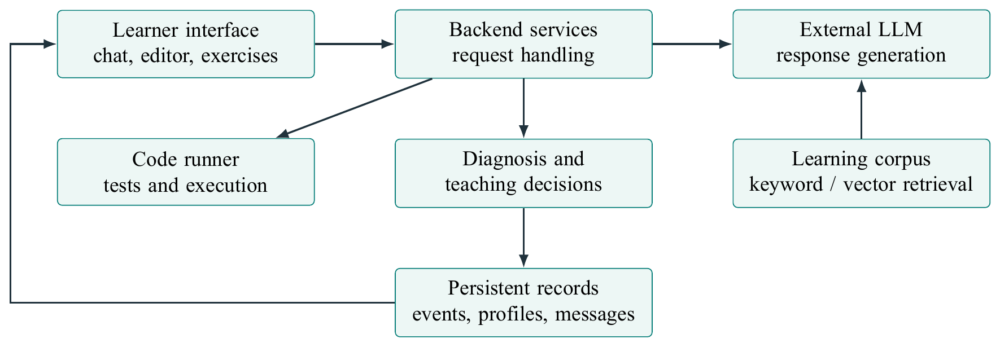
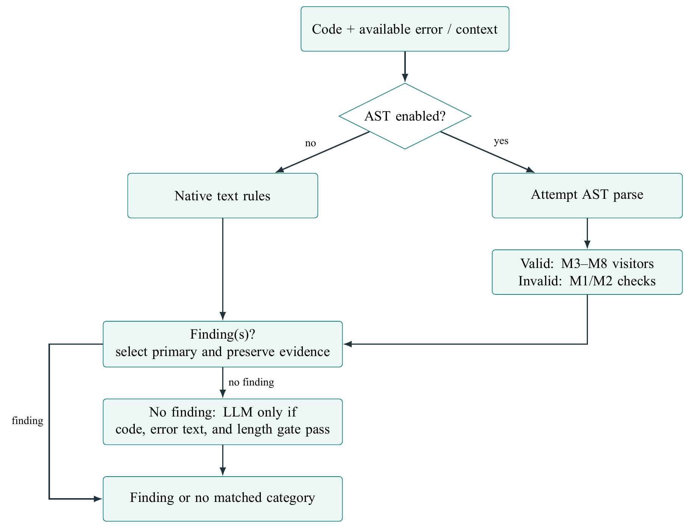
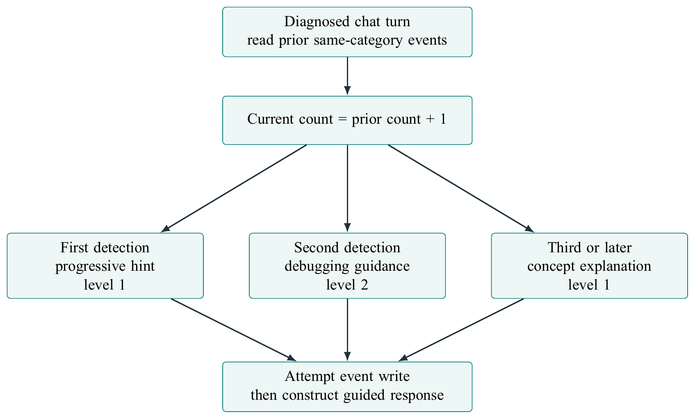

# 1 Introduction

## 1.1 Background and motivation

Beginners must understand how variables receive values, how conditions change execution, and how functions return results. An object may also change without a new object being returned. Sorva frames these difficulties through the notional machine: a learner’s account of how a program executes \[1\]. Syntactically valid code can still reveal confusion about these processes.

Python provides a clear example through methods that modify a list. Consider the following program:

    items = [1, 2]
    new = items.append(5)
    print(new)

The program changes `items` and then prints `None`; methods that modify a list in place normally return `None` \[2\]. If the learner expected `new` to hold the changed list, the useful teaching point is the difference between changing an object and returning a value. Corrected code alone leaves that expectation unexplored.

A single error is weak evidence of a lasting misconception: the assignment could be deliberate, copied, or a slip. In this thesis, *misconception-aware* means linking code patterns to possible conceptual difficulties within a defined catalogue. The label interprets available evidence; it is not direct access to the student’s understanding.

## 1.2 Problem statement, aim, and research questions

Test-based grading checks a program against examples; code analysis can locate structural problems or interpret runtime errors; conversational models can explain results. A tutoring system must decide how to use this information in the learner’s current situation.

Prior support matters: a short prompt may suffice on a first attempt, while repeated difficulty may call for another explanation. Pedagogical steering makes the teaching action explicit \[3\], and coding tutors use learner-state estimates and verify candidate responses \[4\]. These approaches connect a reply to a teaching process across turns.

PyTutor-AI connects code findings with feedback decisions and saved records. A diagnosed turn should expose the matched pattern, the history used by the policy, and the selected strategy. General-purpose LLMs can also explain errors, but the question here is how to implement these decisions explicitly and evaluate their behaviour.

Text matching can flag harmless code or miss syntactic relationships. Structural analysis helps, but still needs context when the answer depends on the task. Chat messages, failed exercises, and hint requests also carry different information and must not be counted interchangeably. The method addresses these issues through separate diagnosis, policy, and recording functions.

The aim is to design, implement, and evaluate PyTutor-AI, a Python tutoring system that uses explicit misconception-related findings to support guided feedback and follow-up practice. The project targets short beginner programs and a selected catalogue of eight categories.

The objectives are to:

1.  identify selected code patterns using syntax, AST structure, and available runtime or task information;

2.  provide a structured diagnosis containing a category, evidence, and method information;

3.  connect diagnosis and recorded history to a defined feedback strategy;

4.  record learning activity and use unresolved weaknesses to support subsequent practice;

5.  evaluate diagnosis, retrieval, and selected integration behaviours using reproducible artefacts.

These objectives separate software behaviour from educational effect; the latter requires a learner study outside the current evidence.

The thesis addresses three research questions:

**RQ1.** Which of the eight selected categories can the structural diagnosis component identify, how does its behaviour compare with the native text-rule baseline, and what happens on separately authored cases and clean-code controls?

**RQ2.** In the current learning corpus, what trade-offs do keyword and vector retrieval show in relevance, ranking, latency, and context size?

**RQ3.** How are diagnosis, teaching decisions, and learner records connected, and which parts of that connection are supported by implementation and functional evidence?

RQ1 is a bounded classification task, RQ2 concerns retrieval rather than generated-reply quality, and RQ3 concerns system design and traceable behaviour. None assumes that component performance proves improved achievement.

## 1.3 Contributions

The diagnosis component covers eight categories. It combines parse-error handling, structural checks, and contextual or runtime signals. Each finding includes inspectable evidence; unmatched code may still contain problems.

Findings and prior records select feedback, while exercise activity updates the records used for review and practice. Decision metadata preserves the strategy and its inputs, allowing behaviour to be checked separately from the generated reply.

The evaluation uses development cases, separately authored holdout cases, clean controls, and retrieval queries. An exploratory experiment tests AST evidence injection without finding a faithfulness improvement. The work applies established ideas in AST analysis, retrieval, guided hints, and content-based recommendation to a specific tutoring system and assesses the resulting behaviour.

## 1.4 Scope and thesis organisation

The system focuses on beginner Python concepts: assignment, indentation, lists, loops, functions, and type conversion. Evaluation data are project-authored rather than collected from a classroom. The analysis does not implement complete Python semantics, infer a verified cognitive state, or prove termination of arbitrary programs. External models provide language generation and optional classification; they were not trained as part of this project.

The source baseline is commit `f7d0aed` of the project repository \[5\]. Historical artefacts and a source-level component recheck are identified in the results.

```{=openxml}
<w:p><w:r><w:br w:type="page"/></w:r></w:p>
```

# 2 Literature Review

## 2.1 Feedback and intelligent tutoring

A failed test shows a mismatch between observed and required behaviour. Explaining it may require an account of execution, such as what a function returns; asking why the learner expected another value goes further. These levels of feedback require different evidence.

Sorva connects misconceptions with mental models of execution \[1\], motivating explanations of runtime behaviour such as mutation versus a returned value; the eight labels here were selected separately. iSnap generates hints from previous submissions and logs hint use in a novice environment \[6\]. Its ideas inform our feedback and recording, but its environment and algorithm are not a numerical baseline for our classifier.

An LLM can phrase an explanation, give an example, or ask a follow-up question; choosing among these requires a teaching policy that considers current difficulty and prior interaction. StratL represents a multi-turn teaching plan as a transition graph and separates teaching intention from the generated utterance \[3\]. PyTutor-AI borrows this separation but uses simpler base rules and does not replicate StratL’s procedure. SocraticLLM uses a Socratic-style dataset and knowledge-enhanced generation for mathematics \[7\], while KELE separates planning and execution through structured rules \[8\]. Both motivate explicit teaching actions; neither establishes the effectiveness of our Python hint policy.

Our policy selects a strategy from the detected category and prior records, and the LLM receives strategy-specific instructions. This avoids reproducing full training or multi-agent procedures; the policy can be checked deterministically, with reply compliance assessed separately.

## 2.2 Misconception-aware code diagnosis

Code can fail because of a misconception, an incomplete edit, or a slip; valid code can also accompany a question that reveals uncertainty. A diagnosis should preserve code and contextual evidence so a teacher can judge the suggested concept.

McMining defines misconception discovery as a task and provides an LLM-based benchmark \[9\]. It studies broader discovery than our fixed checks; our eight labels are a separate selection and do not cover every conceptual difficulty.

Text rules are cheap and can inspect snippets that do not parse, but nearby words need not form the relationship a rule assumes. An AST represents assignments, calls, loops, and returns explicitly \[10\] and can distinguish an assigned method call from text inside a string. Object types and function purpose still need other information; runtime signals and LLM classification add fallible interpretation.

A matching type error can support a finding about an incompatible operation, but a successful run is inconclusive because a program may solve the wrong task. Boundary questions depend on intent: a loop endpoint is only wrong relative to the task. Chapter 3 describes how structural checks use context.

## 2.3 Learner state, practice, and retrieval

TRAVER combines knowledge tracing with turn-by-turn verification in coding dialogue \[4\], assessing replies against evolving task and learner state. Its trained workflow is more extensive than our historical-count policy, which records events without an equivalent knowledge-tracing model.

CoderAgent simulates programming practice, including writing and revising code \[11\]. This motivates recording attempts and support, though simulated trajectories do not validate our heuristic weakness scores.

PyTutor-AI records categories, exercise outcomes, unresolved concepts, and hint use—fields sufficient for review rules and content-based ranking when learner data are limited. Whether recommendations are useful requires ranking or learner evidence.

Lewis et al. combine a language model with retrieved non-parametric memory \[12\]. PyTutor-AI applies retrieve-then-generate to a controlled Python corpus but does not reproduce the original training procedure. The retrieval experiment asks whether useful fragments can be found; keyword matching uses vocabulary overlap, while vector retrieval connects differently worded questions and material. PyTutor-AI can concatenate vector results before keyword results or optionally weight fragments found by both; these configurations must be distinguished when interpreting “hybrid”. A generator may ignore a relevant fragment, and a retriever may supply irrelevant material when no answer exists. We therefore evaluate coverage, ranking, context size, and out-of-corpus queries; reply accuracy requires a further experiment.

## 2.4 Synthesis and research gap

The reviewed studies measure different outcomes—hint use, teaching strategy, coding progress, simulation, and misconception discovery—so their scores cannot rank against our diagnosis percentages. Table 2.1 summarises the ideas used, without claiming exhaustive coverage.

Table 2.1: Representative research and its relationship to PyTutor-AI.

| Work | Contribution reviewed | Relationship to this project |
|:---|:---|:---|
| iSnap \[6\] | Logging and next-step hints in novice programming | Supports process-based feedback; different environment and algorithm |
| StratL \[3\] | Explicit multi-turn teaching plan | Motivates separating teaching control from generation |
| SocraticLLM / KELE \[7, 8\] | Guided dialogue and structured planning | References for feedback intentions; full training procedures not reproduced |
| TRAVER \[4\] | Knowledge tracing and turn verification for coding tutoring | Shows a richer learner-state workflow than historical counts |
| McMining \[9\] | Discovery of misconceptions in student code | Related task; not the direct source of the eight project labels |
| CoderAgent \[11\] | Simulation of iterative programming practice | Motivates trajectory-aware records; not a source of observed users |


```{=openxml}
<w:p><w:r><w:br w:type="page"/></w:r></w:p>
```

# 3 Proposed Method

## 3.1 System overview and requirements

Learners can ask a question in chat or submit code for an exercise. Chat may include a snippet; exercises have test cases and a hint interface. Both paths diagnose but supply different inputs and save different records; runtime information is available only when the calling path supplies it.

The system returns exercise results and, where a pattern matches, a diagnosis with evidence. It uses history to select feedback, saves activity for review, and supplies retrieval, profiles, and recommendations. Authentication and roles support these functions but are not part of the diagnosis method. Services exchange compatible records, handle unavailable dependencies, and keep execution within the runner’s limits. A response retains diagnosis, evidence, strategy, and hint level; sentence-level verification is separate, and AST inspection only reads structure.

<span id="sec:architecture" data-label="sec:architecture"></span> The Next.js and React frontend contains chat, a code editor, exercise pages, and learner views. FastAPI services handle retrieval, diagnosis, generation, execution, and profiles. SQLAlchemy models store users, messages, exercise activity, and misconception records. Conversational generation and vector embeddings use external services; no model was trained for this project.

Figure 3.1 shows the service interfaces. The path taken depends on the request. A concept question may need no code diagnosis, while a failed exercise result can enter diagnosis after grading. Profile reads and writes occur at the points required by each path.

{width=95%}

Chat attempts diagnosis when an input check finds fenced code or a function definition. It passes the extracted code with empty `stderr`, without running the snippet or forwarding the whole question, so an error message elsewhere may never reach the classifier. Exercises run tests and compare outputs; an unsuccessful submission triggers error classification and a diagnosis call with code, runtime information, and exercise description, then records activity and updates weaknesses. The description is task requirements, not the benchmark’s `student_question`.

## 3.2 Diagnosis: categories and routing

Let a diagnosis input be
$$
\begin{equation}
x=(c,e,q),
\end{equation}
$$
where $`c`$ is code, $`e`$ is available runtime error text, and $`q`$ is optional contextual text. Any field other than code may be empty. A finding contains a category $`m\in\mathcal{M}`$, evidence, method information, and selected structural attributes, where $`\mathcal{M}=\{M1,\ldots,M8\}`$. The analyser may return several findings or none. A service response selects a primary finding for the main interface while retaining additional findings when available.

Table 3.1 defines the eight categories selected for this implementation. Each connects a beginner concept with patterns the system can inspect and feedback it can give. Misconception research motivates studying these difficulties \[1, 9\]; the exact selection and numbering belong to this project. Some categories describe error symptoms, so a match alone gives limited evidence of a stable belief.

Table 3.1: Project-selected categories and the main evidence examined. A signal is a heuristic cue, not confirmation of learner intent.

| Code | Category | Main signal |
|:---|:---|:---|
| M1 | Assignment / comparison | Invalid assignment-like syntax in a condition |
| M2 | Indentation | Parse errors and indentation-related patterns |
| M3 | In-place return value | Assignment from a selected mutating method call |
| M4 | Index / value | Iterated element reused as an index of the same object |
| M5 | `range` endpoint | Loop-boundary structure and contextual signals |
| M6 | `print` / `return` | Function output and return-related patterns |
| M7 | Type conversion | Operand cues, lightweight type tracking, and error text |
| M8 | `while` update / condition | Missing update or exit cues in selected loop forms |


Error classification records syntax errors, runtime failures, and output mismatches separately from the labels in $`\mathcal{M}`$. The flag `beyond_misconceptions` is set when an error has no matched category. Its name should be read narrowly: the cause is unclassified, and could still fall within the catalogue. Code with no finding can also contain errors.

<span id="sec:routing" data-label="sec:routing"></span> `ENABLE_AST_DIAGNOSIS` selects the entry path. When off, text rules match code and error text; equal scores go to the first catalogue match. When on, the structural analyser parses the code and runs M3–M8 visitors on a valid tree; if parsing fails, targeted M1/M2 checks use syntax, indentation, and text fallbacks. `ast-only` includes both parse-error rules and valid-AST checks.

After a no-finding result, LLM classification is allowed only for non-empty code with non-empty error text and at most 30 lines. The prompt requests M1–M8 or `none` and defines no new categories. Chat supplies empty error text, so its no-match results normally fail this gate.

{width=95%}

    diagnose(code, error_text, context, ast_enabled):
        if ast_enabled:
            tree, parse_error = safe_parse(code)
            if tree exists:
                findings = run_M3_to_M8_checks(tree, code,
                                             error_text, context)
                sort findings by native rule priority
            else:
                findings = targeted_M1_M2_checks(code, parse_error)
            if findings:
                report evidence scores without re-sorting
                return primary=findings[0], all_findings=findings
        else:
            findings = native_text_matches(code, error_text)
            if findings:
                return first highest-scored finding
        if code nonempty and error_text nonempty and lines <= 30:
            attempt constrained LLM classification
            return accepted finding if one is produced
        return no_matched_category

**Algorithm 1: Diagnosis orchestration, matching the current source-level branches.**

## 3.3 AST checks and evidence scoring

### 3.3.1 Representation and a Worked Example

Python’s `ast` module exposes node types and their relationships \[10\]. In the second line of the introductory example, an assignment contains a call whose function is the attribute `append`. The rule checks that relationship, rather than searching for the word `append` anywhere in the snippet.

{width=95%}

M3 checks an `Assign` whose value is a `Call` to an `Attribute` in a selected method-name set: `append`, `extend`, `insert`, `remove`, `sort`, `reverse`, or `clear`. It returns the line number, target, object expression, and method. Standalone `items.append(5)` does not meet the assignment pattern. Text inside a string is also not interpreted as such a call.

Two limitations follow from this rule. A custom object may have a method of the same name that returns a value. Also, an `AnnAssign` or a call wrapped inside another expression has a different node pattern from a direct assignment value. The current evidence message can give the standard list-method explanation even when the receiver’s type is uncertain. AST parsing exposes the relationship but does not resolve that uncertainty.

### 3.3.2 Container and Loop Checks

M4 finds a simple loop that iterates over an object and then subscripts that same object with the loop variable. It exempts dictionary-like variables inferred from selected literals, constructors, annotations, returns, and parameter names; this reduces false alarms but is not complete type inference, and legal integer-valued sequences can resemble the pattern.

M5 collects `range` arguments and scores references to the stop value, later use of the loop variable, and boundary wording; a finding requires sufficient weighted cues. Several cues are Chinese phrases, so an English paraphrase may behave differently.

M8 examines selected `while` forms for an exit or update to a condition variable, excluding called names and selected built-ins. Marking any condition variable as modified suppresses the warning, which avoids false alarms but can miss non-termination; an exit statement may also be unreachable.

### 3.3.3 Functions and Type-Related Checks

M6 searches for printing without a return where computation is suggested by an expression or function name. Display-oriented names such as `greet` and `show` are exempted. Another check identifies selected print statements following a direct return. These rules help avoid flagging every display function, but exemptions can miss a genuine question about a caller receiving `None`. The check also uses tree walks rather than complete interprocedural control-flow analysis.

M7 tracks selected assignments and conversions to obtain operand and variable-type cues. It combines these with available error text when checking an operation. Aliasing, dynamic calls, and scope can exceed this limited type tracking, and an unusual operation may still be valid Python. Clean examples are therefore necessary alongside erroneous ones when evaluating the rule.

### 3.3.4 Multiple Findings and Primary Selection

A program can produce findings from several visitors. The analyser sorts them by preset rule scores. The service converts their evidence scores, selects the first finding, and retains `all_findings`, but does not re-sort the list. The primary label thus follows the original rule priority even if another candidate receives a higher final score. Neither number is a calibrated probability or a verified causal explanation.

The evaluation compares one expected category with one primary prediction per case. Assessing all issues or a teacher’s preferred ordering would require separate labels and metrics.

The score engine starts with a prior $`p_0=0.30`$ and adds hand-set contributions in log-odds space:
$$
\begin{align}
z &= \log\frac{p_0}{1-p_0}+\sum_i w_i I_i,\\
s &= \min\left(0.95,\max\left(0.15,\frac{1}{1+e^{-z}}\right)\right),
\end{align}
$$
where $`I_i`$ indicates an enabled evidence term. The first and second structural-feature thresholds contribute 0.60 and 0.55. Matching runtime text contributes 1.00. The helper also supports channel-agreement and negative heuristic terms. These terms are part of a score implementation; the main path does not automatically execute three independent diagnostic channels and combine their votes.

For the M3 example without runtime error text, the adapter counts at least two entries in the finding’s feature object. The two structural terms give
$$
\begin{equation}
\operatorname{sigmoid}\left(\log(0.30/0.70)+0.60+0.55\right)\approx0.575.
\end{equation}
$$
The value is a *heuristic confidence score*. The weights have not been fitted or calibrated against human-labelled outcomes. Moreover, feature entries include metadata such as a line number or target name, so counting them does not count independent observations. Calibration remains future work.

## 3.4 Feedback, retrieval, and learner records

For a diagnosed chat turn, the service reads prior events for the same user and category. It passes the count plus one and a history indicator to the base policy, then attempts to record the current event. Reading first keeps the current event out of its own history count. Concurrent or duplicate requests would need additional checks beyond this ordering.

With no prior event, the policy selects `progressive_hint`. The second recorded detection selects `debugging_guidance`; at three or more it selects `concept_explanation`. That last branch returns to hint level 1, so repeated detections do not automatically produce more code or a fuller solution. Figure 3.4 shows the selected strategies and levels.

{width=95%}

The helper also has no-category branches, but chat calls it only in the diagnosed branch, so they do not describe no-match behaviour.

Exercise hints use a separate requested level from 1 to 5: concept, direction, location, partial code, and complete reference. The level is independent of the chat detection count. Level 5 permits a full answer, and generated text at lower levels may still fail to follow the instructions. The interface therefore cannot guarantee that solutions are withheld.

Optional pedagogical steering replaces the base decision with a graph-based choice and further prompt constraints. It is disabled by default, and the present evaluation does not compare its effectiveness with the base policy. Metadata records the selected strategy, level, and diagnosis evidence for either decision path; checking the resulting text remains a separate task.

The corpus contains project-authored Python material. Retrieval uses keyword search and Chroma vector search with external embeddings; the vector service is queried when available, with keyword search as an additional route and fallback. The generator receives selected fragments with other prompt information.

The default merge places vector results before keyword results and removes duplicate chunk IDs, so the top-$`k`$ list may contain only vector results. A separate option weights fragments found by both; reranking and compression have their own controls. With hybrid weights off, hybrid top-five matched vector, leaving no evidence of fusion benefit, and the service lacks a validated abstention rule for out-of-corpus questions.

Misconception events and exercise activity use different routes. Diagnosed chat records category, evidence, score, and a code excerpt; exercises record outcomes and hint activity and update concepts. An exercise failure is not automatically the same event counted by chat. A failed result increments an unresolved concept weakness (severity capped at five), and a success can mark it resolved; these rules maintain records, not validated measures of ability.

The base recommendation prioritises an unresolved weakness, otherwise the next learning-path item and prerequisites. Optional content recommendation compares concept labels and penalises difficulty mismatch, considering up to 100 exercises and five weakness concepts. Optional time decay lowers the weight of older weaknesses without observing improvement; none of these rules is a trained knowledge-tracing model.

## 3.5 Implementation and configuration

Exercises use a common runner; AST parsing does not execute code. When production isolation requires Docker and it is unavailable, the runner returns unavailable or unjudged; a development subprocess is not a substitute. The event writer resolves a catalogue code such as M3 to a database row before the foreign key and logs write failures, which would otherwise leave history counts unchanged; failure and concurrency tests are still needed.

Table 3.2 lists the code defaults and the experimental use of selected options. A deployed environment can override these defaults. The offline experiments call component functions directly, so they do not check all settings in a live application.

Table 3.2: Selected configuration boundaries. “Off” describes the inspected code default.

| Flag | Default | Treatment in this thesis |
|:---|:---|:---|
| `ENABLE_AST_DIAGNOSIS` | Off | Structural component called explicitly in offline evaluation |
| `ENABLE_PEDAGOGY_STEERING` | Off | Optional path; base policy described separately |
| `ENABLE_HYBRID_WEIGHTS` | Off | Off in stored hybrid comparison |
| `ENABLE_MULTI_JUDGE` | Off | Exploratory review evidence only |
| `ENABLE_TIME_DECAY` | Off | Implemented option, no demonstrated learning benefit |
| `ENABLE_CONTENT_RECOMMEND` | Off | Functional mechanism, no ranking-effectiveness result |


Chapter 4 evaluates diagnosis and retrieval and examines integration evidence.

```{=openxml}
<w:p><w:r><w:br w:type="page"/></w:r></w:p>
```

# 4 Experimental Results

## 4.1 Evaluation design, data, protocol, and metrics

We evaluate primary-label diagnosis and fragment retrieval, examine selected software behaviours, and report an exploratory explanation-faithfulness experiment. These measurements concern different parts of the system. Diagnosis scores compare predictions with the authored labels; retrieval scores assess fragments. Neither those scores nor software tests directly measure student learning.

The repository contains JSON and CSV results from earlier evaluations. During thesis preparation we loaded the unchanged diagnosis source, compared predictions with those files, and repeated structural diagnosis without question text. This offline recheck used no database, LLM calls, or student-code execution; retrieval and live-model results come from the earlier files. Classification and clean controls address RQ1, retrieval files and out-of-corpus queries address RQ2, and service calls plus decision examples address RQ3. No user study was conducted.

The project-authored development set contains 47 cases and 22 clean programs, written alongside the rules as regression checks; it is not an independent test sample or training data. The holdout set contains 30 labelled cases and 15 clean controls, written separately before evaluation but still by one author. Table 4.1 summarises the data; labels and the clean/problematic distinction remain author judgements without second-annotator agreement.

The retrieval set labels relevant fragment IDs for 30 answerable queries over 41 fragments from ten documents. Five out-of-corpus queries inspect whether the retriever returns content without an answer and are excluded from relevance averages. The faithfulness set contains ten seeds (five positive, five hard-negative); its denominator shrinks when a reply has no checkable assertion. No real student cohort or outcome data are available.

Table 4.1: Available evaluation data. All sets are project-authored and lack independent double annotation.

| Set | Size | Use and boundary |
|:---|:---|:---|
| Diagnosis development | 47 labelled cases | Rules and cases developed together |
| Development controls | 22 clean programs | Observed false alarms on prepared examples |
| Diagnosis holdout | 30 labelled cases | Separately written; still single-author |
| Holdout controls | 15 clean programs | Small negative-control set |
| Retrieval queries | 30 answerable + 5 unanswerable | Fragment-level relevance; unanswerable cases separate |
| Retrieval corpus | 10 documents / 41 fragments | Project-authored learning material |
| Faithfulness seeds | 10 items | Exploratory comparison; incomplete assertion coverage |


<span id="sec:conditions" data-label="sec:conditions"></span> The regex baseline uses `_rule_match` with the original catalogue; inputs are code and runtime text, and equal scores select the first category. The recheck compiles this function from the source syntax tree and makes no fallback model call. Structural conditions call the unchanged `analyze_misconceptions` and select the first finding, with two inputs: code + error (same fields as regex) and code + error + benchmark question (the historical setting). Both include M1/M2 parse checks and exclude the LLM fallback.

We loaded the analyser from the project source with an inert logging shim; every with-question prediction matched the earlier JSON. The check reproduces component predictions but not database, interface, or external-model paths. Stored retrieval results use hybrid weights off, and timings include different service costs.

For $`N`$ positive cases, primary-label exact match is
$$
\begin{equation}
\mathrm{EM}=\frac{1}{N}\sum_{i=1}^{N}\mathbf{1}[\hat{m}_i=m_i].
\end{equation}
$$
A missing label counts as an incorrect prediction. For each of the eight labels, precision, recall, and F1 are computed from true positives, false positives, and false negatives. Macro-F1 averages the eight class F1 values. In this protocol these class metrics use category-positive cases; clean-control false alarms are reported separately:
$$
\begin{equation}
\mathrm{FPR}_{\mathrm{clean}}=
\frac{\text{clean programs receiving any category}}{\text{number of clean programs}}.
\end{equation}
$$
The denominator distinction matters when comparing with another study that includes clean examples in class precision. The recheck computes unrounded class values before rounding the final macro average; the historical script rounds individual class F1 values first. The displayed structural macro results agree at three decimal places.

For retrieval, let $`R_q`$ be the annotated relevant set and $`S_{q,k}`$ the returned top-$`k`$ set for an answerable query $`q`$. Hit@$`k`$ averages whether $`R_q\cap S_{q,k}`$ is non-empty. Recall@$`k`$ averages $`|R_q\cap S_{q,k}|/|R_q|`$. MRR averages the reciprocal of the first relevant rank, or zero when none is returned in the evaluated list. Larger values are better for these relevance metrics.

The splitter estimates context-token counts; they are not exact tokenisation or billed usage. Latencies are reported in milliseconds, with hardware, network, warm-up, and cache conditions uncontrolled in the available runs. Counts accompany percentages because the samples are small. In particular, observing no false alarms in 15 controls leaves uncertainty about the rate on other code.

## 4.2 RQ1: diagnosis results and failure analysis

Table 4.2 reports the offline recheck. The with-question rows reproduce earlier structural predictions; the other rows provide the native baseline and the code-plus-error comparison. All rows exclude LLM classification.

Table 4.2: Diagnosis component results. Exact match and macro-F1 use labelled positive cases; clean false alarms have their own denominator. All conditions exclude LLM fallback.

| Set         | Condition                 | Correct | Macro-F1 | Clean FP |
|:------------|:--------------------------|:--------|:---------|:---------|
| Development | Native text rules         | 12/47   | 0.268    | 15/22    |
| Development | Structural, code + error  | 43/47   | 0.917    | 0/22     |
| Development | Structural, with question | 47/47   | 1.000    | 0/22     |
| Holdout     | Native text rules         | 13/30   | 0.356    | 10/15    |
| Holdout     | Structural, code + error  | 24/30   | 0.833    | 0/15     |
| Holdout     | Structural, with question | 25/30   | 0.883    | 0/15     |


With question text, structural analysis identified all 47 development labels and left 22 controls unflagged; the native rules identified 12 and flagged 15. The 100% result reflects coverage of cases developed with the rules, not unrestricted generalisation, and the baseline is the project’s old rules. With code and runtime text, structural analysis identified 24/30 holdout labels (80.0%) against 13/30 (43.3%) for native rules; a tuned text classifier or general-purpose model would require another comparison. Adding question text recovered one holdout case, raising exact match to 25/30 (83.3%) and macro-F1 to 0.883; it also recovered four development cases, all M5. Neither structural condition flagged the 15 holdout controls, while the text baseline flagged ten; these controls are too few to estimate performance on arbitrary valid Python.

Table 4.3 gives the per-category holdout results; each class has only three or four positives, and all five misses are no-label outcomes.

Table 4.3: Structural with-question results on the 30 positive holdout cases. Each class has very small support.

| Category | Support |  TP | Precision | Recall |    F1 |
|:---------|--------:|----:|----------:|-------:|------:|
| M1       |       4 |   4 |     1.000 |  1.000 | 1.000 |
| M2       |       4 |   4 |     1.000 |  1.000 | 1.000 |
| M3       |       4 |   4 |     1.000 |  1.000 | 1.000 |
| M4       |       4 |   4 |     1.000 |  1.000 | 1.000 |
| M5       |       4 |   1 |     1.000 |  0.250 | 0.400 |
| M6       |       4 |   2 |     1.000 |  0.500 | 0.667 |
| M7       |       3 |   3 |     1.000 |  1.000 | 1.000 |
| M8       |       3 |   3 |     1.000 |  1.000 | 1.000 |


The M5 misses are H18, H19, and H20. H18 iterates over `range(0,3)` and asks whether it should reach 3. H19 iterates over `range(2,8)` and asks why the maximum is 7. H20 uses `range(1,4)` and asks whether 4 is included. These are legitimate Python loops; the intended misconception label is supplied by the question. The structural input alone cannot establish that the learner expected an inclusive endpoint.

M5’s wording cues miss several of these paraphrases. One loop also exceeds the small-range cue and lacks the structural signals needed to pass the threshold. The failures point to specific gaps in the current rules and context handling. Testing those gaps is a more direct next step than increasing the complexity of diagnosis without knowing which inputs are missing.

The M6 misses are H22 and H24. H22 defines `greet`, prints a greeting, assigns the function’s result, and asks why it is `None`. H24 does the same through a function named `show`. Both names are exempted as display functions. That exemption avoids some false alarms, but it also prevents these cases from receiving M6. The M6 visitor does not use the supplied learner question to override the exemption or analyse the caller’s expectation.

These labels also need review. A greeting function can correctly print a message and return nothing; the caller’s question may reveal uncertainty rather than a defect in the function. The dataset nevertheless asks for a misconception-related teaching label. Future annotations should distinguish the program’s behaviour from the learner’s question and any inferred misconception.

## 4.3 RQ2: retrieval trade-offs

In the stored top-five results, vector retrieval found a relevant fragment for 28 of 30 answerable queries, compared with 27 for keyword retrieval (Table 4.4). Recall rose by 0.094 while MRR fell by 0.010. More relevant material was retrieved overall, but the first relevant fragment did not always rank as early. The Hit@5 difference amounts to one query in this small set.

Table 4.4: Stored retrieval results at $`k=5`$ over 30 answerable queries and 41 corpus fragments. Context sizes are estimates; vector times include an external embedding call.

| Mode                | Hit@5 | Recall@5 | MRR   | Mean ms | Context tokens |
|:--------------------|:------|:---------|:------|:--------|:---------------|
| Keyword             | 0.900 | 0.407    | 0.900 | 0.1     | 250.6          |
| Vector              | 0.933 | 0.501    | 0.890 | 635.6   | 314.7          |
| Hybrid, weights off | 0.933 | 0.501    | 0.890 | 641.1   | 314.7          |


Vector retrieval used more estimated context tokens on average, so this configuration offered no token saving. Its longer latency includes network and embedding-service time. The keyword result, meanwhile, is small enough to be sensitive to timer resolution and warm-cache behaviour. These measurements describe the recorded service paths rather than the isolated complexity of their ranking algorithms.

Hybrid retrieval produced the same relevance scores and context size as vector retrieval because weights were off and vector results filled the top five positions. Its mean recorded time was 641.1 ms. To assess fusion itself, the weighted scoring rule would need to be enabled, documented, and compared on these queries.

Every mode returned fragments for all five unanswerable queries. The mean top score was 1.000 for keywords and 0.498 for vectors, on different scoring scales. Neither is calibrated as an answerability probability. The retrieval layer therefore supplied content without recognising these cases as outside its corpus. We did not test whether the generator then answered, declined, or corrected that context.

## 4.4 RQ3: integration and functional evidence

The latest change record reports 272 passing backend tests and 12 excluded tests, compared with the older count of 251 in the README and reproducibility documents. We retain the newer count as a historical record. Thesis preparation rechecked diagnosis components only; it did not rerun the full suite, the excluded external-service tests, or the frontend build.

Diagnosed chat turns retain the category, evidence, score, strategy, hint level, and prior-event count in metadata. The source can be followed for M3: with no prior event, the policy selects progressive hinting at level 1, and later detections change the strategy according to history. The component recheck verified the example’s M3 finding and score of 0.575. No live reply or new database write was checked in that run.

Exercise submissions record outcomes and update concept weaknesses through their own path. Recommendations read unresolved concepts or follow the learning path. These calls are present in the source, but successful commits and concurrent updates need service-level testing with a controlled database. Exercise failures should also be checked separately from the events used to count chat misconceptions.

Table 4.5 lists the available checks and the questions they leave open.

Table 4.5: Evidence level for the main mechanisms.

| Mechanism | Available evidence | Remaining question |
|:---|:---|:---|
| Diagnosis | Native-source recheck and historical predictions | Independent real-code performance |
| Teaching selection | Policy source and historical tests | Reply compliance and pedagogical value |
| Event / weakness update | Service calls and historical functional tests | Failure, duplication, and concurrency behaviour |
| Practice suggestion | Implemented rules and content ranking | Recommendation quality and learner outcomes |
| Code execution boundary | Runner/configuration source and historical tests | Deployment-specific security validation |


### 4.4.1 Exploratory explanation-faithfulness experiment

The research directory contains a small real-model comparison between C1, explanation from code alone, and C2, explanation after AST facts are supplied. The recorded generator is `deepseek-chat`, with temperature 0.3 and a 600-token output limit. Each run uses ten seeds under both conditions. A deterministic rule extractor and verifier assess selected structural assertions. The cleaned extractor version, `rules_v2`, is used for the current reported results.

Table 4.6: Existing exploratory faithfulness results. Scores cover only replies producing checkable assertions. The paired differences use five scored pairs in each run.

| Run | C1 score | C2 score | C1 scored | C2 scored |
|:----|---------:|---------:|----------:|----------:|
| 1   |    0.683 |    0.647 |      5/10 |      7/10 |
| 2   |    0.667 |    0.650 |      6/10 |      7/10 |


The stored paired mean differences, C2 minus C1, are $`-0.127`$ and $`-0.090`$. Their reported 95% intervals are $`[-0.564,0.206]`$ and $`[-0.190,0.000]`$. These are existing report outputs, not newly estimated intervals. Because coverage differs between conditions, the paired differences should not be reconstructed by simply subtracting the aggregate score columns in Table 4.6.

Evidence injection did not yield an established improvement in either run. With only five scored pairs per run, the comparison is too limited to conclude that C1 is generally better or that structural evidence is unhelpful. The assertion process also lacks an independent human audit, and changes in Markdown filtering altered its denominator. The pilot confirms that the pipeline ran, but the current measurement provides no validated estimate of how people would judge the explanations.

## 4.5 Discussion, limitations, and reproducibility

### 4.5.1 Diagnosis findings (RQ1)

The equal-input comparison answers RQ1: structural checks identified 24/30 holdout labels against 13/30 for native rules, with fewer clean alarms; development showed the same pattern. The increase to 25/30 used additional question text, so the full difference is not attributable to AST alone.

M5 failures concern which context reaches the rule and how it is interpreted; M6 failures concern a valid display function used by a caller expecting a value. Adding category names would not resolve these; clearer annotations and input handling are needed. Method-name matching, dictionary exemptions, and update heuristics can also fail on valid code, and the existing score leaves that uncertainty unquantified.

### 4.5.2 Retrieval trade-offs (RQ2)

Vector retrieval found more relevant material at the cost of more context and an external call, while ranking the first fragment slightly later. Keywords may suffice for a small corpus; semantic retrieval may help paraphrases, but the present set is too small to establish that division.

The unanswerable queries show why rejection needs separate evaluation: a retriever can return a fragment without suitable material. Future tests should measure rejection, coverage, and generator use of context.

### 4.5.3 Tracing feedback decisions (RQ3)

Service code and metadata expose the diagnosis and history behind a decision, so the strategy can be reconstructed. Whether it was the right action requires feedback or learner evaluation. Chat and exercises pass different inputs and save different events; the benchmark question does not reach diagnosis through chat, and optional mechanisms may be disabled. Integration studies should specify entry point, configuration, starting profile, expected writes, and output.

### 4.5.4 Interpreting the evidence-injection pilot

AST facts describe structure, but explaining difficulty may also require task intent and a teaching action. Low assertion coverage and the rule verifier limit the pilot; prompt design, fact selection, and extraction language were not isolated in an ablation. Auditing the measurement is necessary before general conclusions.

### 4.5.5 Limitations and threats to validity

#### 4.5.5.1 Internal validity

Development cases and rules were constructed together; holdout cases were separately written but share the same project context. The component recheck removes database and model dependencies, reproducing analyser predictions but not service failures or fallback performance; question text creates an input difference controlled only by the code-plus-error condition. Historical retrieval times are not hardware-controlled, and the artefacts lack a complete warm-up/cache protocol, so latency is an operational snapshot.

#### 4.5.5.2 Construct validity

Labels can combine a buggy pattern, valid code with uncertainty, and an inferred belief; a primary-label score measures agreement with the authored catalogue, not confirmed understanding. Weakness severity and event counts are operational records, not validated mastery. Retrieval relevance measures fragments, not explanations; automatic review and assertion verifiers measure their own rubrics, and the faithfulness pilot has no independent human reference.

#### 4.5.5.3 External and conclusion validity

The data contain short selected programs, few examples per class, a small corpus, and many Chinese query or phrase cues. Other courses, languages, styles, libraries, and longer programs may behave differently. No external benchmark, independent double annotation, or classroom cohort is included; repeated runs do not add independent seeds. Grades, workload, retention, and ranking effectiveness were not measured.

### 4.5.6 Data handling and reproducibility

The datasets are project-authored, not private student submissions. The application can send prompts, code, and context to external services; deployment would require notice, access controls, and institutional approval, none of which is claimed here. The package retains the recheck script, per-case outputs, hashes, source map, and historical result copies; it identifies the source commit and separates recorded model experiments from new offline checks.

```{=openxml}
<w:p><w:r><w:br w:type="page"/></w:r></w:p>
```

# 5 Conclusion

## 5.1 Answers to research questions

PyTutor-AI uses code findings to inform feedback and retain records for practice. It implements parse-error checks and AST visitors for eight categories, a teaching policy, and retrieval.

On the 30 positive holdout cases, structural diagnosis with code and runtime text identified 24 expected labels, compared with 13 for the native text rules; adding the benchmark question raised this to 25. Neither structural condition raised a false alarm on the 15 holdout controls. Endpoint questions and display functions whose callers expected a returned value accounted for the misses.

Vector retrieval found a relevant fragment for one more of the 30 answerable queries and increased recall, but ranked some relevant fragments later and used more context and an external embedding call. Hybrid produced no established fusion benefit; all five out-of-corpus queries still received fragments, and the faithfulness pilot found no benefit from AST injection.

Source inspection documents how diagnosis, policy, and records connect, with optional features separated from evaluated conditions. Further evidence is needed for reply compliance, mastery estimates, or learning gains; the results do not support claims of replacing a teacher or generally outperforming conversational models.

## 5.2 Contributions revisited

The project contributes an inspectable diagnosis layer, a simple policy that turns findings and prior events into teaching decisions, a record structure linking practice to later support, and a reproducible evaluation of component behaviour. These are engineering and evaluation contributions within the tested system; they do not establish classroom learning gains.

## 5.3 Future work

Diagnosis needs cases written and reviewed independently of rule development, distinguishing program defects from concept questions and inferred misconceptions. The M5/M6 failures target context routing and call-site interpretation; revised rules should become regression-tested on a new held-out set.

Service paths need controlled integration tests starting from known history, inspecting diagnosis inputs, selected strategy, reply, and saved events. Missing context, unavailable services, duplicate requests, and failed writes need separate cases; the restricted LLM fallback needs trigger-rate, error, and cost measurements.

Human reviewers and a learner study, subject to approval, should assess evidence justification, hint appropriateness, and changes in understanding with a defined comparison; until then, conclusions apply to the authored cases and implementation examined here.

```{=openxml}
<w:p><w:r><w:br w:type="page"/></w:r></w:p>
```

# References

\[1\] Juha Sorva. Notional machines and introductory programming education. *ACM Transactions on Computing Education*, 13 (2): 1–31, 2013. doi: 10.1145/2483710.2483713.

\[2\] Python Software Foundation. Data structures. The Python Tutorial, Section 5, n.d.a. URL `https://docs.python.org/3/tutorial/datastructures.html`. Accessed 20 November 2026.

\[3\] Romain Puech, Jakub Macina, Julia Chatain, Mrinmaya Sachan, and Manu Kapur. Towards the pedagogical steering of large language models for tutoring: A case study with modeling productive failure. arXiv:2410.03781v2, 2025. URL `https://arxiv.org/abs/2410.03781v2`. Version 2, 18 March 2025; first submitted in 2024.

\[4\] Jian Wang, Yinpei Dai, Yichi Zhang, Ziqiao Ma, Wenjie Li, and Joyce Chai. Training turn-by-turn verifiers for dialogue tutoring agents: The curious case of LLMs as your coding tutors. In *Findings of the Association for Computational Linguistics: ACL 2025*, pages 12416–12436, 2025. doi: 10.18653/v1/2025.findings-acl.642. URL `https://aclanthology.org/2025.findings-acl.642/`.

\[5\] PyTutor-AI project team. PyTutor-AI: Source code and evaluation artefacts, 2026. URL `https://github.com/zengqikai/pytutor-ai`. Commit f7d0aed594a1589ff1fe24c2cb0222c149abe322, 1 November 2026.

\[6\] Thomas W. Price, Yihuan Dong, and Dragan Lipovac. iSnap: Towards intelligent tutoring in novice programming environments. In *Proceedings of the 2017 ACM SIGCSE Technical Symposium on Computer Science Education*, pages 483–488, 2017. doi: 10.1145/3017680.3017762.

\[7\] Yuyang Ding, Hanglei Hu, Jie Zhou, Qin Chen, Bo Jiang, and Liang He. Boosting large language models with socratic method for conversational mathematics teaching. In *Proceedings of the 33rd ACM International Conference on Information and Knowledge Management*, pages 3730–3735, 2024. doi: 10.1145/3627673.3679881.

\[8\] Xian Peng, Pan Yuan, Dong Li, Junlong Cheng, Qin Fang, and Zhi Liu. KELE: A multi-agent framework for structured socratic teaching with large language models. In *Findings of the Association for Computational Linguistics: EMNLP 2025*, pages 16342–16362, 2025. doi: 10.18653/v1/2025.findings-emnlp.888. URL `https://aclanthology.org/2025.findings-emnlp.888/`.

\[9\] Erfan Al-Hossami and Razvan Bunescu. McMining: Automated discovery of misconceptions in student code. arXiv:2510.08827, 2025. URL `https://arxiv.org/abs/2510.08827`.

\[10\] Python Software Foundation. ast — abstract syntax trees. Python documentation, n.d.b. URL `https://docs.python.org/3/library/ast.html`. Accessed 20 November 2026.

\[11\] Yi Zhan, Qi Liu, Weibo Gao, Zheng Zhang, Tianfu Wang, Shuanghong Shen, Junyu Lu, and Zhenya Huang. CoderAgent: Simulating student behavior for personalized programming learning with large language models. arXiv:2505.20642v1, 2025. URL `https://arxiv.org/abs/2505.20642v1`. Preprint version consulted.

\[12\] Patrick Lewis, Ethan Perez, Aleksandra Piktus, Fabio Petroni, Vladimir Karpukhin, Naman Goyal, Heinrich Küttler, Mike Lewis, Wen-tau Yih, Tim Rocktäschel, Sebastian Riedel, and Douwe Kiela. Retrieval-augmented generation for knowledge-intensive NLP tasks. arXiv:2005.11401, 2020. URL `https://arxiv.org/abs/2005.11401`. Accepted at NeurIPS 2020.

# A Source and Evidence Map

The source examined is commit `f7d0aed594a1589ff1fe24c2cb0222c149abe322` of the project repository \[5\]. We checked it against the remote commit during outline preparation. Paths below refer to that repository unless marked as thesis-local. Result files from earlier runs are identified separately; a fresh full-system evaluation was not performed for every artefact.

Table A.1: Implementation sources used for the manuscript

| Mechanism | Source path |
|:---|:---|
| Diagnosis routing | `backend/app/services/misconception_service.py` |
| Structural orchestration | `backend/app/analysis/ast_analyzer.py` |
| Category visitors | `backend/app/analysis/ast_visitors.py` |
| Evidence scoring | `backend/app/analysis/confidence.py` |
| Observable error classes | `backend/app/analysis/error_class.py` |
| Category catalogue | `backend/app/data/misconceptions.json` |
| Teaching policy | `backend/app/services/pedagogy_service.py` |
| Chat integration | `backend/app/services/chat_service.py` |
| Exercise integration | `backend/app/api/v1/exercises.py` |
| Profile and recommendations | `backend/app/services/profile_service.py` |
| Optional time decay | `backend/app/services/profile_decay_service.py` |
| Retrieval integration | `backend/app/services/rag_service.py` |
| Execution boundary | `backend/app/sandbox/runner.py` |
| Feature defaults | `backend/app/core/config.py` |


## A.1 Historical Evaluation Artefacts

The diagnosis files are `evaluation/v2_eval_results.json` and `evaluation/v2_holdout_results.json`. The four input files are `v2_test_cases.json`, `clean_code_cases.json`, `v2_holdout_cases.json`, and `holdout_clean_cases.json` in the same directory. The historical with-question prediction for every positive case was reproduced by the thesis component recheck.

The retrieval files are `evaluation/rag_eval_results_tfidf.json`, `evaluation/rag_eval_results_vector.json`, and `evaluation/rag_eval_results_hybrid.json`. Query labels are in `evaluation/rag_golden.json`. The exploratory explanation experiment is documented in `research/faithfulness/RESULTS.md` and the two `results_real_deepseek_v2_run1.json` and `results_real_deepseek_v2_run2.json` files. The reported observations use these real-model outputs, excluding the stub-model demonstration.

## A.2 Recheck Procedure

The thesis-local `evidence/recheck_components.py` script takes an optional `--repo` path. It loads the original visitors and analyser, compiles the original text-match function, supplies the existing input cases, and saves per-case predictions in `evidence/component_recheck.json`. The JSON also records the Python version, source commit, input hashes, and class counts. The structural with-question predictions are asserted equal to the historical files. The M3 example and its evidence score are checked separately.

    python evidence/recheck_components.py --repo PATH_TO_REPOSITORY

The command reproduces component predictions. It leaves external-model runs, database state, application tests, and historical timing outside its scope. The logging shim runs only within the recheck process and changes no production source file.

# B Additional Evaluation Details

## B.1 Category Support

| Set         |  M1 |  M2 |  M3 |  M4 |  M5 |  M6 |  M7 |  M8 |
|:------------|----:|----:|----:|----:|----:|----:|----:|----:|
| Development |   4 |   3 |   7 |   7 |   5 |   6 |   8 |   7 |
| Holdout     |   4 |   4 |   4 |   4 |   4 |   4 |   3 |   3 |


Table B.1: Number of positive cases by category. Clean controls are counted separately.

## B.2 Boundary Examples

The M3 visitor identifies the direct assignment in the first example. The other forms lack that node pattern. These examples examine the visitor alone; a service with further fallback handling may return a different result.

    # Direct assignment from an attribute call: M3 pattern.
    new = items.append(5)

    # Standalone mutation: not the assignment pattern.
    items.append(5)

    # Annotated assignment: AnnAssign, not Assign.
    new: object = items.append(5)

    # Wrapped call: assignment value is a List, not Call.
    new = [items.append(5)]

Even a direct assignment can have a different meaning for a custom object whose `append` method returns a value. Receiver type and task purpose are therefore separate questions from the node relationship.

## B.3 Exploratory Automatic Review

The historical multi-judge report covers ten examples, with a mean score of 2.40, revision rate of 9/10, and mean inter-judge agreement of approximately 0.405. There is no human reference. These values describe the automated review process: agreement between judges leaves agreement with educators untested, and the revision count does not show whether revisions improved a reply. The pilot is insufficient to validate teaching quality.

# C Reproducibility and Interpretation Checklist

The following distinctions govern reuse of the results:

1.  Development cases validate current coverage; they do not provide independent generalisation evidence.

2.  Holdout cases were separately authored within the project, not collected from an external learner population.

3.  Structural diagnosis with a benchmark question has different information from the native text baseline and from current chat routing.

4.  The `ast-only` component includes targeted handling of parse errors and excludes the LLM service fallback.

5.  A primary label is selected by rule priority before evidence-score conversion; it is not a validated cognitive root cause.

6.  Code defaults, documented demonstration settings, stored experimental settings, and a deployed environment are distinct configurations.

7.  Retrieval scores do not measure final-answer faithfulness; automatic review does not measure learning gains.

8.  The current preparation rechecked components, not the full historical backend suite or a fresh external-model run.

The accompanying editing notes list the evidence still needed before final submission. They contain no additional experimental results.